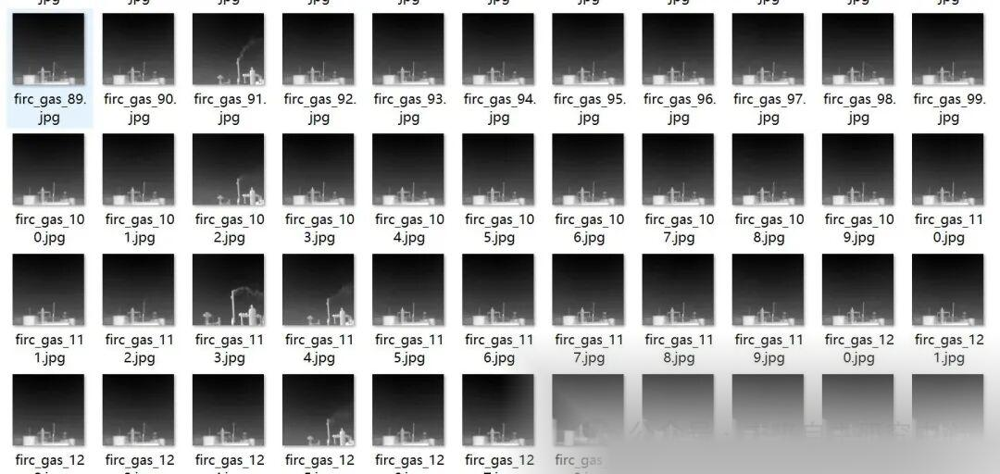
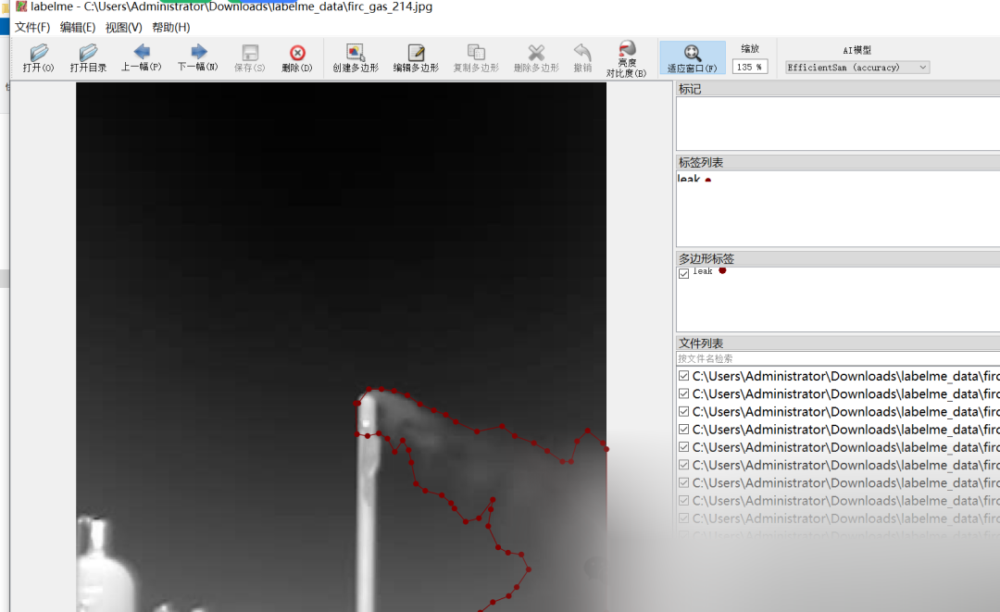

# Gas Leak Segmentation Dataset - LabelMe format: 1612 categories

The dataset is all from a scene shot, all black background, mainly applicable to industrial gas cylinder gas leakage scenes.

Dataset format: labelme format (without mask files, only including jpg images and corresponding json files)

Number of images (number of jpg files): 1612

Number of annotations (json file count): 1612

Label category count: 1

Label category name: ["leak"]

Number of boxes labeled in each category:

leak count = 1692

Using labeling tool: labelme=5.5.0

Annotation rules: Draw polygons around the categories.

Important Notice: The dataset can be opened and edited using LabelMe. For JSON datasets, one must convert them into mask or Yolo formats for semantic segmentation or instance segmentation.

Special : This dataset does not guarantee the accuracy or precision of the trained models or weight files. The dataset is provided with accurate and reasonable annotations only.

Image Preview:

Annotation example:

## Payment

Here is a pay link on Stripe ( https://buy.stripe.com/3cs8yP7sY87d0vu9AB ). Please contact me lonlonago@foxmail.com after funding $89, and I will send you a complete data files , thank you!

